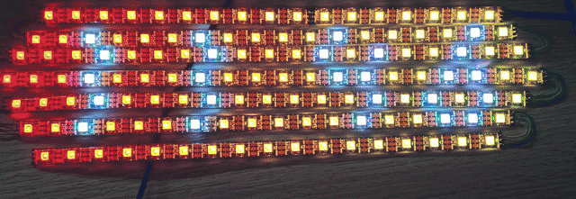
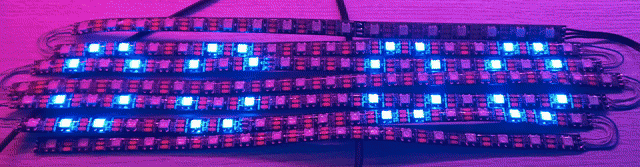
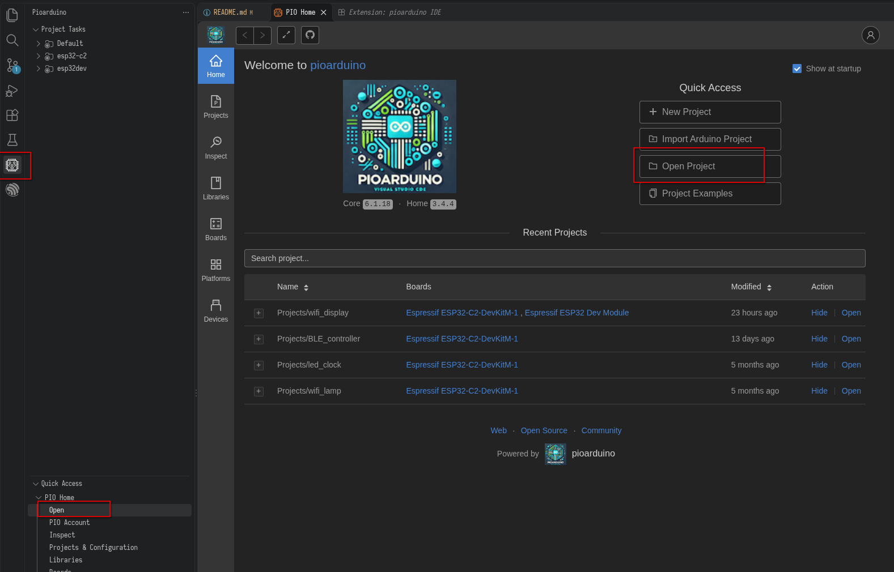
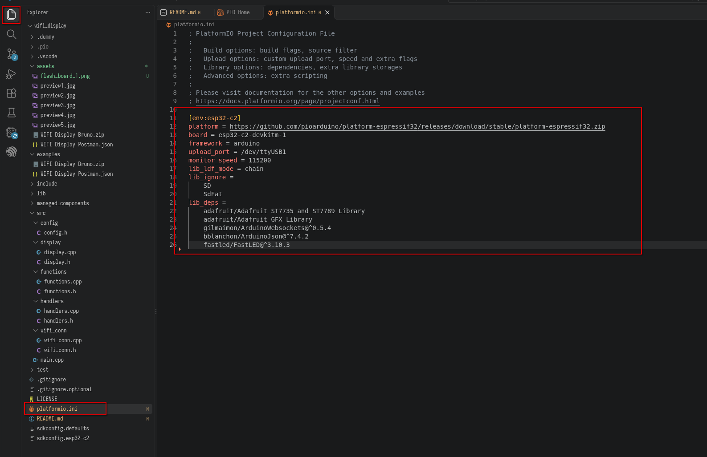
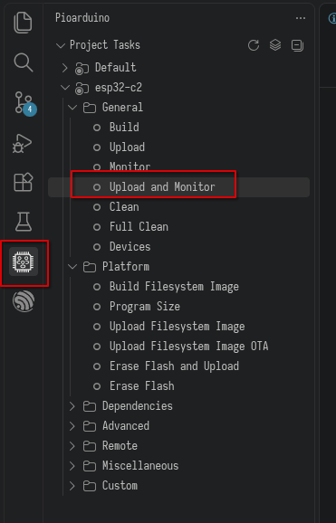

# Led-clock
Clock made out of led strips, controlled by ESP8684

  

[High resolution - Preview 1](./assets/preview_1.gif)

  

[High resolution - Preview 2](./assets/preview_2.gif)

## Configuration

### Edit the `/src/main.cpp` file

### LED Configuration

| Variable | Description | Default value |
|---|---|---|
| `LED_PIN` | GPIO pin connected to the LED strip's DIN (Data In) | `0` |
| `LED_TYPE` | Type of LED strip | `WS2812B` |
| `COLOR_ORDER` | Order of RGB color channels | `GRB` |
| `BRIGHTNESS` | Brightness (0–255) | `60` |
| `main_color` | Color of the numbers and dots in the middle | `CRGB::Black` |
| `BACKGROUND_BRIGHTNESS` | Brightness of the background effect (0–255) | `255` |

### WiFi Configuration

| Variable | Description |
|---|---|
| `ssid` | WiFi network name |
| `password` | WiFi network password |

## Flash board

1. **Install the PlatformIO IDE extension** (`pioarduino IDE`) in Visual Studio Code.

2. **Open your project** in VS Code.

   

     
   

3. **Check the configuration.** Make sure all settings are correct and that `upload_port` points to the port connected to your board.

   

     
   

4. **Flash your board** using the Upload command.

   

     
   
